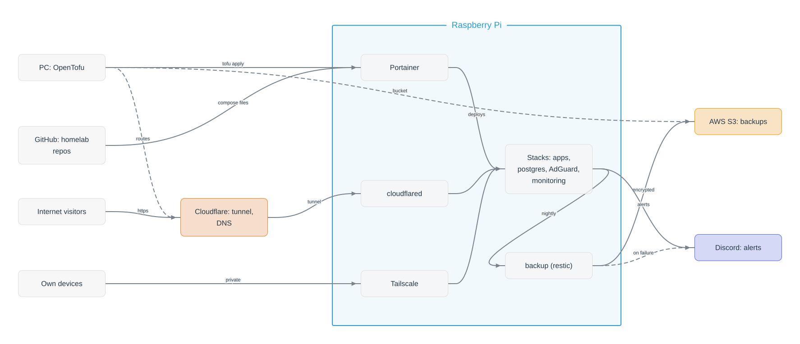

<h1 align="center">
    homelab
</h1>

<p align="center">
    Infrastructure as code for a self-hosted Raspberry Pi server: Docker stacks, helper scripts and write-ups of the setup and the problems solved along the way.
</p>

<p align="center">
    
    
    
    
</p>

<p align="center">
    
    <br>
    <sub><i>How the parts fit together; dashed links are set up once by OpenTofu. Drawn with <a href="https://kutaycoskuner.github.io/imge/">imge</a>, source: <a href="graphs/20261101-architecture_v1.json">graphs/20261101-architecture_v1.json</a></i></sub>
</p>

------------------------------------------------------------------------------------------

## What this repo does

- describes every service running on the Pi as a Docker Compose stack, so the server can be rebuilt from this repo
- holds small helper scripts that run next to the stacks (e.g. a CPU temperature guard)
- documents how the server was set up and why things are the way they are
- contains **no secrets and no personal data**: every confidential file is committed only as a `.example` copy with placeholder values (see [Secrets and example files](docs/secrets-and-examples.md))

------------------------------------------------------------------------------------------

## Services

What runs on the server; "reached" says who can open it: anyone through the Cloudflare Tunnel, only your own devices (home network, Tailscale), or nobody, for services that only send things out.

| Service | What it does | Reached |
|---|---|---|
| [Portainer](stacks/portainer/README.md) | Docker web UI; deploys the stacks from git | private (LAN, Tailscale) |
| [cloudflared](stacks/cloudflared/README.md) | Cloudflare Tunnel: public subdomains without open ports | outbound only |
| [Tailscale](stacks/tailscale/README.md) | private access from your own devices | private |
| [AdGuard](docs/stack-adguard.md) | network-wide DNS with ad and tracker blocking | home network |
| [PostgreSQL + pgAdmin](docs/stack-postgres.md) | shared database for own apps | private |
| [Umami](docs/stack-umami.md) | website analytics | public (tunnel) |
| [Media server](docs/stack-media-server.md) | files from a folder as web addresses | public (tunnel) |
| [Monitoring](docs/monitoring.md) | checks the sites, alerts to Discord | private |
| [Backup](docs/backup.md) | nightly encrypted backup to S3 | outbound only |
| [hello](stacks/hello/README.md) | one-page test site for a deploy | public (tunnel) |
| [temp_control](scripts/temp_control/README.md) | CPU temperature guard, shutdown when too hot | — |

------------------------------------------------------------------------------------------

## How the owner runs it

This repo is kept person-agnostic on purpose, so anyone can use it as is. The owner's own server runs it together with a **private companion repo**:

```text
homelab           (this repo, public)   how things are set up: stacks, scripts, OpenTofu modules, docs
homelab-private   (private)             what runs on the owner's server: which stacks, domain, routes, notes on own apps
```

- the private repo calls this repo's `tofu/portainer`, `tofu/cloudflare`, `tofu/github` and `tofu/uptimerobot` folders as OpenTofu modules and passes its own values; secrets stay local and gitignored in both, the states are in an S3 bucket ([State in S3](docs/terraform.md#state-in-s3))
- a fix here reaches the owner's server on the next `tofu apply` there, and nothing personal ever has to be committed here
- you can do the same with a private repo of your own: [Your own values in a private repo](docs/terraform.md#your-own-values-in-a-private-repo); or skip it and fill in the `.example` files here

------------------------------------------------------------------------------------------

## Folders

```text
homelab/
├── README.md              this file
├── main.py                creates and checks your local .env files from the examples
├── docs/                  setup guides and write-ups, see docs/README.md
├── display/               images for the README (SVG, PNG, JPG), e.g. the architecture graph
├── graphs/                imge graph sources (JSON) the images in display/ are exported from
├── stacks/<service>/      docker-compose.yml + .env.example + README per service
│   ├── portainer/         Docker web UI
│   ├── adguard/           DNS with ad and tracker blocking for the whole network
│   ├── postgres/          shared database for own apps, with pgAdmin
│   ├── umami/             self-hosted website analytics
│   ├── nextcloud/         your own cloud storage, with its own database
│   ├── media-server/      files from a folder as web addresses (images for websites)
│   ├── monitoring/        checks that the sites answer, alerts to Discord; the server's numbers; configured as code (blackbox, Prometheus, Alertmanager, node-exporter)
│   ├── backup/            nightly, encrypted backup of databases and data to S3 (restic), Discord on failure
│   ├── _idle/             stacks not in use, kept for later (uptime-kuma); not tested or deployed
│   ├── tailscale/         private access from your own devices
│   ├── cloudflared/       Cloudflare Tunnel: public subdomains without open ports
│   └── hello/             one-page test site to check a deploy end to end
├── tofu/                  OpenTofu, in use: Cloudflare tunnel routes and DNS, Portainer stacks with automatic updates, AWS buckets for backups and the tofu states, PostgreSQL users, GitHub Actions secrets, UptimeRobot outside checks
├── legacy/                replaced code kept for reference (terraform/cloudflare, superseded by tofu/cloudflare)
├── renovate.json          settings for automatic update pull requests
├── scripts/               helper scripts
│   ├── server_base/       installs and updates Docker and Portainer
│   ├── copy_tfvars_values/  copies OpenTofu values between .tfvars files without showing them
│   └── temp_control/      CPU temperature guard (Discord report, shutdown when too hot)
│
│   planned:
├── stacks/...             the other services
└── roadmap.md             services to add next
```

------------------------------------------------------------------------------------------

## Usage

From an empty server to running stacks in four steps; the full walkthrough, with accounts and integrations: [00 · From zero to a running server](docs/00-from-zero.md).

```bash
# 1. get the repo (on the server)
git clone https://github.com/kutaycoskuner/homelab.git
cd homelab

# 2. install Docker and Portainer (scripts/server_base)
bash scripts/server_base/server_base.sh --install   # installs Docker, adds you to the docker group
    newgrp docker                                    # or log out and back in
bash scripts/server_base/server_base.sh --install   # second run starts Portainer

# 3. set up your values: personal files exist only as <file>.example
python main.py --sync                               # creates your .env files from the examples, then fill them in
    python main.py --check                           # after every git pull: still matching their examples?
    # OpenTofu folders: copy terraform.tfvars.example to terraform.tfvars next to it (docs/terraform.md)

# 4. deploy the stacks, once you have the integration keys (GitHub, Cloudflare, Tailscale, Discord; see Documentation)
tofu -chdir=tofu/portainer apply                    # as code, from your PC: stacks with automatic updates
    tofu -chdir=tofu/cloudflare apply                # public routes and DNS
    # or by hand: in Portainer, a stack from this repository per service
```

Your copies (`.env`, `terraform.tfvars`) are gitignored and never committed. Stacks deployed through Portainer take the same keys as environment variables instead. Details: [Secrets and example files](docs/secrets-and-examples.md#syncing-your-copies).

------------------------------------------------------------------------------------------

## Documentation

- [docs/README.md](docs/README.md): index of all docs
    - [Secrets and example files](docs/secrets-and-examples.md): how confidential values are kept out of the repo
    - [CI](docs/ci.md): what GitHub Actions checks on every push
    - [Terraform and OpenTofu](docs/terraform.md): Cloudflare routes and Portainer stacks as code, run from your PC
    - [Updates](docs/updates.md): new image versions as pull requests, deployed by Portainer after merge
    - [00 · From zero to a running server](docs/00-from-zero.md): the whole setup in order, from an empty machine to all stacks running
    - [01 · Headless server setup](docs/01-headless-server-setup.md): install the OS and reach the server over the network (Raspberry Pi as the example)
    - [02 · Docker and Portainer](docs/02-docker-portainer.md): container runtime and its web UI
    - [03 · Exposing services](docs/03-exposing-services.md): public through a Cloudflare Tunnel, private through Tailscale
    - optional stacks: [AdGuard](docs/stack-adguard.md) (network-wide ad and tracker blocking), [PostgreSQL](docs/stack-postgres.md) (shared database with pgAdmin), [Umami](docs/stack-umami.md) (website analytics), [Nextcloud](docs/stack-nextcloud.md) (cloud storage), [Media server](docs/stack-media-server.md) (files as web addresses), [Monitoring](docs/monitoring.md) (alerts to Discord when a site is down, as code), [Backup](docs/backup.md) (nightly, encrypted, to S3; restore); idle: [Uptime Kuma](docs/stack-uptime-kuma.md)
    - [Discord webhook](docs/integrations/discord-web-hook.md): messages from scripts to a Discord channel
    - [Tailscale](docs/integrations/tailscale.md) and [Cloudflare Tunnel](docs/integrations/cloudflare-tunnel.md): private and public access
    - [GitHub read-only token](docs/integrations/github-read-token.md): lets Portainer clone the private repo
    - [Portainer webhook](docs/integrations/portainer-webhook.md): an app's CI redeploys its stack right after pushing a new image
    - Scripts: [server_base](scripts/server_base/README.md) (Docker and Portainer), [copy_tfvars_values](scripts/copy_tfvars_values/README.md) (OpenTofu values into new files), [temp_control](scripts/temp_control/README.md)
